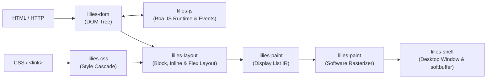

<div align="center">

# 🪷 lilies

**L**ightweight **I**nline **L**ayout and **I**nterface **E**ngine **S**ystem

*An independent, modular web browser rendering engine and interactive desktop browser written from scratch in pure, 100% safe Rust.*

[](https://www.rust-lang.org/)
[%5D-success?style=flat)](crates/)
[](crates/)
[](crates/lilies-shell)

</div>

---

## ⚡ Quick Start

Launch the desktop browser with the built-in welcome page:

```bash
cargo run -p lilies-shell
```

Navigate to a live remote website over HTTPS:

```bash
cargo run -p lilies-shell -- https://example.com
```

Load any local HTML file:

```bash
cargo run -p lilies-shell -- file:///path/to/page.html
```

---

## ✨ Features

- **🌐 Live HTTP / HTTPS & File Fetching**: TLS network stack powered by `ureq` with redirects, custom User-Agent, and `file://` local URL handling.
- **📄 WHATWG HTML Parsing**: Resilient tokenizer and tree constructor supporting character reference decoding (`&amp;`, `&lt;`, `&mdash;`, numeric `&#...;` / `&#x...;`), raw text elements (`<script>`, `<style>`), self-closing tags, and automated `<p>` / scoped `<li>` auto-closing.
- **🎨 CSS Cascade & Inheritance**: Parser supporting compound, descendant (`div p`), child (`div > p`), and pseudo-class selectors, `@charset`/`@import` handling, `!important` precedence, specificity calculation, inline `style="..."` overrides, `<style>` block extraction, and external `<link rel="stylesheet">` fetching with caching.
- **📏 Flexible Units, Box Model & Flexbox**: Concrete pixel resolution for `px`, `em`, `rem`, `vh`, `vw`, and `pt`; Block Formatting Context (BFC) with margins, padding, CSS borders (`border`, `border-width`, `border-color`), `margin: auto` centering, and `max-width`; Horizontal Inline Formatting Context (IFC); and CSS Flexbox (`display: flex`, `flex-direction`, `justify-content`, `align-items`, `gap`, `flex-grow`).
- **⚡ JavaScript Engine & DOM Bindings (`lilies-js`)**: Embedded ECMAScript runtime powered by `boa_engine` supporting `<script>` and external `<script src="...">` execution, non-JS script type filtering, `querySelector` / `querySelectorAll` / `getElementById` / `getElementsByClassName` / `getElementsByName` / `getElementsByTagName`, live DOM tree mutation (`createElement`, `appendChild`, `insertBefore`, `removeChild`, `remove`, `replaceChild`, `cloneNode`), HTML serialization (`innerHTML`, `outerHTML`), tree traversal (`children`, `childNodes`, `firstElementChild`, `lastElementChild`, `nextElementSibling`, `previousElementSibling`, `nodeType`, `nodeName`, `nodeValue`), `classList`, reactive `style` proxies, timer and animation queues (`setTimeout`, `setInterval`, `requestAnimationFrame`), W3C event listeners and dispatching with bubbling, cancellation, and `CustomEvent`, and Web APIs (`performance.now()`, `localStorage`, `sessionStorage`, `history`, `URL`, `URLSearchParams`, `btoa`/`atob`, `fetch`, `location`).
- **🔤 Typography & Alignment**: Glyph text measurement and line wrapping via `fontdue`, multi-line reflow, line-height calculation, and `text-align` (`left`, `center`, `right`).
- **🖌️ Display List & Alpha Blending**: Display list IR intermediate compilation, software rasterizer with per-pixel alpha blending, background and border rendering, and softbuffer frame presentation.
- **🖼️ Image Rendering & Replaced Element Layout (``)**: Binary asset fetching (`png`, `jpeg`, `webp`, `gif`), thread-safe image caching (`ImageCache`), replaced element layout with intrinsic aspect ratio preservation (`width`, `height`, `max-width`), and Porter-Duff Source-Over alpha blending with viewport clipping.
- **🖱️ Interactive Browser Shell**:
  - URL address bar with click-to-focus, text cursor, and full typing/backspace editing.
  - **Modern Page Loading Bar**: Visual progress bar along the toolbar with background track, Catppuccin Blue fill, and glowing leading edge.
  - **Link Hover URL Preview**: Bottom-left status pill showing the resolved target URL when hovering hyperlinks, with dynamic cursor avoidance (automatically flips to the bottom-right corner when cursor approaches).
  - Built-in demo pages (`about:welcome`, `about:images`, `about:flex`, `about:js`).
  - Hyperlink and interactive element hit-testing with dynamic pointer cursor, click event dispatch, and one-click navigation.
  - Linear browsing history stack with backward navigation (`Alt + Left` or `Backspace`) and forward navigation (`Alt + Right`).
  - Live page reload (`F5` or `Ctrl + R` / `Cmd + R`) and address bar editing cancellation (`Escape`).
  - Smooth vertical mouse-wheel scrolling.
- **🛡️ 100% Safe Rust**: `#![deny(unsafe_code)]` enforced across every single crate.

---

## 🏛️ Architecture Pipeline



---

## 📦 Workspace Crates

| Crate | Directory | Purpose |
|---|---|---|
| `lilies-dom` | [`crates/lilies-dom`](crates/lilies-dom) | Arena-allocated DOM tree (`Node`, `Element`, `Text`, `Document`) with cyclic-dependency prevention. |
| `lilies-html` | [`crates/lilies-html`](crates/lilies-html) | HTML tokenizer with entity decoding, tree builder, auto-closing mechanics, and `<style>`/`<link>` extraction. |
| `lilies-css` | [`crates/lilies-css`](crates/lilies-css) | CSS parser, combinator/pseudo-class matcher, specificity & `!important` cascade, borders, and unit resolver. |
| `lilies-layout` | [`crates/lilies-layout`](crates/lilies-layout) | Block, inline, replaced image, and flexbox layout engine with text wrapping, `max-width`, and `text-align`. |
| `lilies-paint` | [`crates/lilies-paint`](crates/lilies-paint) | Display list compiler, software rasterizer with alpha blending, borders, and pixel buffer export. |
| `lilies-net` | [`crates/lilies-net`](crates/lilies-net) | HTTP/HTTPS and `file://` fetcher with TLS, image decoding, and `ImageCache`. |
| `lilies-js` | [`crates/lilies-js`](crates/lilies-js) | ECMAScript engine (`boa_engine`) with DOM tree querying, manipulation, W3C events, timers, `innerHTML`/`outerHTML`, and Web APIs. |
| `lilies-shell` | [`crates/lilies-shell`](crates/lilies-shell) | Desktop browser UI (`winit` + `softbuffer`), address bar, hit-testing, JS event dispatch, and navigation loop. |

---

## 🎮 Controls & Shortcuts

| Action | Shortcut / Trigger |
|---|---|
| **Focus Address Bar** | Click inside the top toolbar address box |
| **Navigate** | Press `Enter` with address bar focused |
| **Cancel Address Editing** | `Escape` (unfocuses address bar and restores current URL) |
| **Click Links** | Left click on any `<a href="...">` text link |
| **Preview Link Target** | Hover cursor over any link (displays destination in bottom-left status pill) |
| **Page Loading Indicator** | Visual progress bar along toolbar bottom during page load |
| **Go Back** | `Alt + Left Arrow` (or `Backspace` when address bar is unfocused) |
| **Go Forward** | `Alt + Right Arrow` |
| **Reload Page** | `F5` or `Ctrl + R` / `Cmd + R` |
| **Scroll Page** | Mouse wheel or trackpad vertical scroll gesture |

---

## 🧪 Testing & Verification

Run the full automated test suite across all workspace crates:

```bash
cargo test --workspace
```

Run Clippy strict lints with zero warnings:

```bash
cargo clippy --workspace --all-targets -- -D warnings
```
