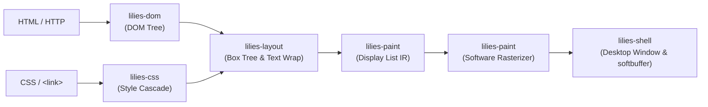

<div align="center">

# 🪷 lilies

**Lightweight Inline Layout and Interface Engine System**

*An independent, modular web browser rendering engine and interactive desktop browser written from scratch in pure, 100% safe Rust.*

[](https://www.rust-lang.org/)
[%5D-success?style=flat)](crates/)
[](crates/)
[](crates/lilies-shell)

</div>

---

## ⚡ Quick Start

Launch the desktop browser with the built-in welcome page:

```bash
cargo run -p lilies-shell
```

Navigate to a live remote website over HTTPS:

```bash
cargo run -p lilies-shell -- https://example.com
```

Load any local HTML file:

```bash
cargo run -p lilies-shell -- file:///path/to/page.html
```

---

## ✨ Features

- **🌐 Live HTTP / HTTPS & File Fetching**: TLS network stack powered by `ureq` with redirects, custom User-Agent, and `file://` local URL handling.
- **📄 WHATWG HTML Parsing**: Resilient tokenizer and tree constructor supporting self-closing tags, nested hierarchies, and automated paragraph auto-closing (`<p>` tag repair).
- **🎨 CSS Cascade & Inheritance**: Parser supporting CSS selectors (element, class, ID, combinations), specificity calculation, inline `style="..."` overrides, `<style>` block extraction, and external `<link rel="stylesheet">` fetching with URL resolution.
- **📏 Flexible Units & Layout**: Concrete pixel resolution for `px`, `em`, and `rem` units based on element and root document font-sizes.
- **📦 CSS Box Model**: Block Formatting Context (BFC) with horizontal margins, padding, border calculations, centering with `margin: auto`, and `max-width` clamping.
- **🔤 Typography & Alignment**: Glyph text measurement and line wrapping via `fontdue`, multi-line reflow, line-height calculation, and `text-align` (`left`, `center`, `right`).
- **🖌️ Display List & Alpha Blending**: Display list IR intermediate compilation, software rasterizer with per-pixel alpha blending, background color rendering, and softbuffer frame presentation.
- **🖼️ Image Rendering & Replaced Element Layout (``)**: Binary asset fetching (`png`, `jpeg`, `webp`, `gif`), thread-safe image caching (`ImageCache`), replaced element layout with intrinsic aspect ratio preservation (`width`, `height`, `max-width`), and Porter-Duff Source-Over alpha blending with viewport clipping.
- **🖱️ Interactive Browser Shell**:
  - URL address bar with click-to-focus, text cursor, and full typing/backspace editing.
  - Hyperlink hit-testing with dynamic pointer cursor and one-click navigation.
  - Linear browsing history stack with backward navigation (`Alt + Left` or `Backspace`).
  - Smooth vertical mouse-wheel scrolling.
- **🛡️ 100% Safe Rust**: `#![deny(unsafe_code)]` enforced across every single crate.

---

## 🏛️ Architecture Pipeline



---

## 📦 Workspace Crates

| Crate | Directory | Purpose |
|---|---|---|
| `lilies-dom` | [`crates/lilies-dom`](crates/lilies-dom) | Arena-allocated DOM tree (`Node`, `Element`, `Text`, `Document`) with cyclic-dependency prevention. |
| `lilies-html` | [`crates/lilies-html`](crates/lilies-html) | HTML tokenizer and tree builder, auto-closing mechanics, and `<style>`/`<link>` style source extraction. |
| `lilies-css` | [`crates/lilies-css`](crates/lilies-css) | CSS parser, specificity sorting, cascade resolution, inheritance, and `px`/`em`/`rem` unit resolver. |
| `lilies-layout` | [`crates/lilies-layout`](crates/lilies-layout) | Box model layout engine, anonymous block grouping, text wrapping, `max-width`, and `text-align`. |
| `lilies-paint` | [`crates/lilies-paint`](crates/lilies-paint) | Display list compiler, software rasterizer with alpha blending, and pixel buffer export. |
| `lilies-net` | [`crates/lilies-net`](crates/lilies-net) | HTTP/HTTPS and `file://` fetcher with TLS and configurable request headers. |
| `lilies-shell` | [`crates/lilies-shell`](crates/lilies-shell) | Desktop browser UI (`winit` + `softbuffer`), address bar, hit-testing, link clicks, and event loop. |

---

## 🎮 Controls & Shortcuts

| Action | Shortcut / Trigger |
|---|---|
| **Focus Address Bar** | Click inside the top toolbar address box |
| **Navigate** | Press `Enter` with address bar focused |
| **Click Links** | Left click on any `<a href="...">` text link |
| **Go Back** | `Alt + Left Arrow` (or `Backspace` when address bar is unfocused) |
| **Scroll Page** | Mouse wheel or trackpad vertical scroll gesture |

---

## 🧪 Testing & Verification

Run the full automated test suite across all workspace crates:

```bash
cargo test --workspace
```

Run Clippy strict lints with zero warnings:

```bash
cargo clippy --workspace --all-targets -- -D warnings
```
